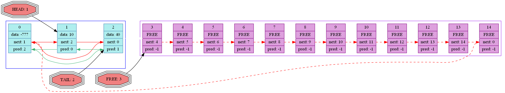
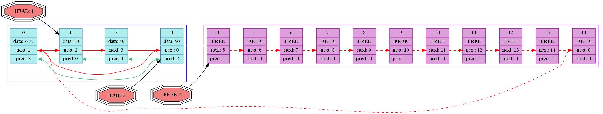

# 📋 Линейный список на основе массива с визуализацией



Проект реализует высокоэффективный линейный список на базе массива с автоматической визуализацией состояния данных. Решение обеспечивает оптимальную производительность операций вставки/удаления с детальным логированием и графическими дампами.

## ✨ Ключевые особенности

- 🚀 **Оптимизированные операции** - O(1) для вставки/удаления
- 📊 **Автоматическая визуализация** - генерация PNG после каждой операции
- 🔍 **Встроенная валидация** - проверка целостности данных
- 📝 **HTML-логирование** - детальный отчет с графикой
- 🔄 **Автосортировка** - оптимизация доступа к элементам
- 🐧 **Кроссплатформенность** - поддержка Linux и Windows

## 🗂 Структура проекта

```bash
.
├── list/               # Реализация списка
│   ├── include/        # Заголовочные файлы
│   └── src/            # Исходный код
├── log/                # Система логирования
│   ├── img/            # Генерация изображений
│   ├── include/
│   └── src/
├── make/               # Конфигурация сборки
│   └── Makefile
├── Main.c              # Точка входа
└── README.md           # Документация
```

## ⚙️ Требования

- Компилятор GCC
- Graphviz (для визуализации)
- Стандартные библиотеки C

### Установка зависимостей (Ubuntu)

```bash
sudo apt update && sudo apt install gcc graphviz -y
```

## 🚀 Запуск проекта

```bash
# Сборка
cd make/
make

# Запуск (из корня проекта)
cd ..
./hello

# Очистка
cd make/
make clean
```

## 🧪 Пример работы программы

```text
Создание списка...
Вставка элемента 10
Вставка элемента 40
Удаление элемента по индексу 3
Поиск элемента 60... найден по индексу 5
Сортировка списка...
```

## 📊 Результаты работы

Результаты сохраняются в папке `log/`:

| Файл | Описание |
|------|----------|
| `logfile.html` | Интерактивный лог операций |
| `img/list*.png` | Графические дампы состояния списка |

## 📚 Основные функции API

```c
// Инициализация списка
int ListCtor(struct List* my_list, int size);

// Освобождение ресурсов
int ListDtor(struct List* my_list);

// Вставка элемента
int ListInsertAfter(struct List* my_list, int index, elem_t element);

// Удаление элемента
int ListDelete(struct List* my_list, int index);

// Поиск элемента
int ListFind(struct List* my_list, int value);

// Сортировка списка
int ListSort(struct List* my_list);

// Генерация дампа
void GraphicDump(struct List* my_list);
```

## 🖼 Визуализация

Каждый дамп включает:
- Состояние массива данных
- Связи между элементами
- Свободные ячейки памяти
- Позиции головы/хвоста
- Информацию о свободных элементах



## 📝 Логирование

Система логирования предоставляет:
- Хронологию операций
- Визуализацию изменений
- Информацию об ошибках
- Статистику использования памяти
- Ссылки на графические дампы
